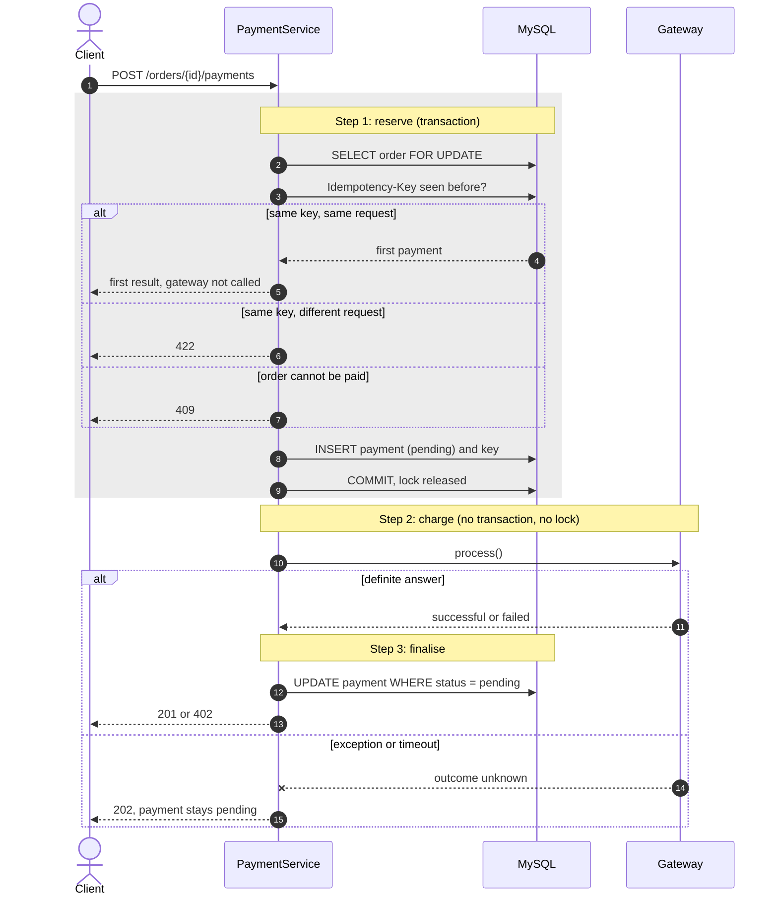

# Decision: payment flow and failure handling

**Status:** accepted. Gateways in this project are simulated, so "the gateway" below
means whatever implements `PaymentGatewayContract`.

## Problem

Payment used to run the gateway call inside the transaction that held the order's row
lock. That had three consequences:

- A slow gateway held a row lock and a database connection for the whole call. Any update,
  delete or payment on that order waited, and enough slow calls would exhaust connections.
- A crash rolled the transaction back, erasing the only record that a charge had been
  attempted.
- A client whose response was lost could not retry safely.

## Decision

Payment has three steps, and no lock or transaction is held during the second.

A pending payment blocks new attempts on the order (409) and counts as "has payments",
so the order's items and total cannot change while a charge is in flight.

## What happens to a payment stuck in pending

A payment stays pending if the process dies during step 2, or if the gateway throws. In
both cases nobody knows whether money moved, so it is never reported as failed on the
spot: a client told "failed" would retry and could be charged twice.

`payments:expire-stale` runs every five minutes through the scheduler. It marks payments
pending for at least `PAYMENT_PENDING_TTL_MINUTES` (default 15) as `failed`, with the
message "Expired: the gateway outcome was never confirmed." The order can then be paid
again. An order can stay blocked for up to the TTL plus five minutes. Production must run
`php artisan schedule:run` every minute.

**Before using a real gateway:** expiry assumes no money moved, which is only safe because
the gateways are simulated. A real gateway needs a status lookup, and expiry must ask it
before failing a payment. Send the payment UUID as the provider's idempotency key, so a
repeated call cannot charge twice. The TTL must also exceed the gateway's longest possible
call.

## When the gateway answers after expiry

Expiry is a guess, and a late answer is a fact. Each payment is finalised once, so a row
that is no longer pending can only have been expired.

- A late success replaces the `failed` status and saves the reference. The order then
  counts as paid, so `reserve()` refuses any further charge. The write takes the order lock,
  so a new reservation cannot slip past that check.
- A late decline or `pending` answer keeps `failed` and saves the reference.
- Every late result is logged as critical for manual review.

A retry that started after expiry and before the late answer is a real second charge, which
no code can undo. Both payments are recorded and the log entry identifies the order, so
someone can refund one.

## Outcomes

| Situation | Payment | Response |
|-----------|---------|----------|
| Gateway approves | `successful` | 201 |
| Gateway declines | `failed` | 402 |
| Gateway throws or times out | `pending` | 202 |
| Process killed during the call | `pending` | none; expired later |
| Another attempt while pending | unchanged | 409 |
| Replay, same key and request | unchanged | the payment's current result |
| Same key, different request | unchanged | 422 |
| Gateway answers `pending` | `pending` | 202 |
| Successful result cannot be saved | stays `pending` after 3 attempts | 202, logged as critical with the reference |
| Late success, after expiry | becomes `successful` | 201, logged as critical |
| Late decline, after expiry | stays `failed`, reference saved | 402, logged as critical |
| Late `pending`, after expiry | stays `failed`, reference saved | 409, logged as critical |

## Idempotency

`Idempotency-Key` is optional. Keys are stored as SHA-256 hashes under
`UNIQUE(user_id, key_hash)`. A hash of the path, query string, validated method and raw body
detects reuse, so a retry must resend the same bytes.

- The order lock serialises duplicates on one order. The unique constraint settles one key
  racing across two orders, where each request holds a different lock.
- A replay renders the stored payment, which does not change once finalised, so no response
  snapshot is kept. The exception is a replay of a pending payment: it reports the current
  state, which later becomes the final result.
- A key is consumed only when a payment is reserved. A request refused earlier (409 or 422)
  can be repeated with the same key once the problem is fixed.

## Alternatives rejected

- **Keep the gateway call inside the transaction.** Simple, but it causes the problems above.
- **Mark the payment failed on any gateway exception.** Simple, but a timeout does not mean
  no charge happened, and it invites a double charge.
- **Snapshot responses for replay.** Duplicates data the payment row already holds.
- **Require the header.** Would break existing clients.

## Known limitations

- Cancelling a paid order issues no refund. An order can also now be cancelled during a
  charge, where cancelling used to wait for the lock, so a charge can complete on an
  already-cancelled order. The end state is the same as paying and then cancelling, and the
  payment records what the gateway did, but there is no refund flow for either.
- A gateway exception raised before the provider is reached, such as a bad
  `CREDIT_CARD_OUTCOME`, looks like a timeout: the payment stays pending until it expires.
  This errs on the side of never reporting a failure that may be false.
- A payment the expiry marks `failed` cannot be retried with the same key: a retry needs a new one.
- A gateway that answers `pending` for a truly asynchronous payment has no webhook to
  complete it, so the payment expires.
- Idempotency keys are never pruned.
- No trusted proxies are configured, so behind a load balancer all callers would share one
  IP and therefore the login and register limits.
